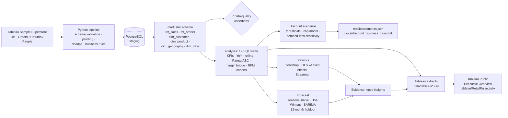

# RetailPulse: Retail Profitability Intelligence for Tableau

**A Tableau-first BI platform that explains why profit lags revenue.** A reproducible Python pipeline loads retail transactions into a PostgreSQL star schema. Twelve SQL analytical views and a statistics layer feed a published Tableau **Executive Overview** dashboard with year-over-year KPIs, parameter-driven metric switching and Top N ranking, and insight text computed from the data.

> **Data honesty up front:** the dataset is **Tableau's official Sample Superstore, a synthetic dataset**. It is the only well-known public retail dataset with recorded profit *and* discount fields at line level. Every finding below describes this sample, not a real company.

**Live dashboard:** [RetailPulse Executive Overview on Tableau Public](https://public.tableau.com/app/profile/neha.kothavade/viz/RetailPulse_ExecutiveOverview_approved/ExecutiveOverview)


## The business problem

Revenue is growing but profit is not keeping pace. Leadership's questions, and what this data says:

| Question | Answer | Evidence |
|---|---|---|
| Is profitability declining? | Revenue grew **21.4%** in 2026, but profit grew only **16.0%**, and margin moved from 13.46% to **12.87% (−0.6pp)**. **The total-margin dip is not statistically significant** (order-level bootstrap 95% CI −5.6 to +4.8pp). | Descriptive + bootstrap |
| Where is margin falling? | The margin bridge splits the −0.60pp into **+1.26pp from favourable mix** and **−1.86pp from lower margins within sub-categories**. The largest falls: **Machines −11.7pp, Binders −9.9pp, Tables −8.4pp**. | SQL decomposition (reconciles exactly) |
| Are discounts reducing profitability? | Strongly associated. The three biggest margin falls all came with deeper discounts (**+8.2, +7.4, +5.1pp** discount rate). Across all 17 sub-categories, discount change tracks margin change (**Spearman ρ −0.66, p 0.004**). **Every discount level from 30% up loses money**. Lines discounted above 20% are 15.7% of revenue and lose **$136K**. | Association, not causation |
| How strong is the discount link at line level? | With sub-category, region and segment held fixed, **+10 points of discount ↔ −19.9pp line margin** (95% CI −20.3 to −19.5; R² 0.82). | OLS, HC1 robust SEs |
| Which products and regions underperform? | **304 of 1,894 products lose money** in total ($77.6K, equal to 26.6% of total profit). **Central** has the lowest margin (7.9%) and the deepest discounting (24.6%). 12 states/provinces are loss-making, led by **Texas, Ohio and Pennsylvania**. | Descriptive |
| Which segments contribute most? | Consumer brings the most revenue ($1.17M) at the lowest margin (11.6%). Home Office has the highest margin (14.0%). | Descriptive |
| How does retention look? | 98.5% of customers order more than once. Quarterly cohorts average **35.7% active four quarters after first purchase**. | Cohort analysis |
| What should we expect next? | Holt-Winters projects **$735K** of revenue for the next 12 months, but with **~23% monthly error** on the 2026 holdout. **Sep, Nov and Dec run 63–82% above** an average month. | Time-based validation |

**Recommendation:** cap discounts at 20% company-wide, starting with Machines, Binders and Tables, and roll the cap out as a randomized test. Test a tighter cap in Tables, Storage and Supplies, where a 20% discount already loses money. Start a price and discount review with the most exposed products and the three worst states. This follows from the associations above and the modeled scenarios below; a test is how to establish causation.

## Discount optimization and what-if scenarios

Full business case, methodology and risks: **[docs/discount_business_case.md](docs/discount_business_case.md)**.

> The thresholds are observed associations. The dollar figures are **modeled opportunities, not realized savings**.
> They come from repricing 2026 order lines under stated assumptions, on synthetic data.

| Question | Answer |
|---|---|
| Where does discounting stop paying? | Every category is profitable at a 20% discount. Losses start at 30% (Furniture), 40% (Technology) and 70% (Office Supplies). In **Tables, Storage and Supplies**, the 20% level already loses money. |
| What is at stake? | In 2026, lines discounted above 20% (463 of 3,379) lost **$47.8K**, against total profit of $95.9K. |
| Which products are most exposed? | High-ticket machines, binding systems and conference tables. The top one, a 3D printer, lost $9.2K on two deep-discount lines. |
| What would a cap do? | A **20% cap** models **+$47.8K to +$71.9K** profit, and +$65.9K if 25% of the capped volume is lost. Margin moves from 12.87% to 20.5–22.6%. |
| Why 20% and not 10%? | A 10% cap shows more on paper (+$98.4K at 25% demand loss), but it also caps profitable 15–20% lines. If that capped volume is lost, its gain falls to +$14.0K. A 20% cap only touches discount levels that already lose money, so profit rises whatever share of that volume is lost. |

| Margin by discount level | Modeled profit change by cap and demand loss |
|---|---|
|  |  |

**The model.** Lines above the cap are repriced at list × (1 − cap), with unit cost held fixed. A demand-loss share
L, from 0% to 100%, removes that part of their revenue and cost. The recommendation rule is coded and tested: among
caps that touch only loss-making discount levels, pick the one with the largest gain at L = 25%. Outputs are in
`results/scenarios.json` and `scenarios.csv`.

## Dataset

| | |
|---|---|
| Source | [Tableau Sample – Superstore](https://public.tableau.com/app/sample-data/sample_-_superstore.xls), downloaded by the pipeline from Tableau's sample-data page (sha256 `5045ed4fec49cae2cc0fdc5ab0d204ba09efa767fe00c996822499e8cc42fbbd`, last saved Oct 2025) |
| Nature | **Synthetic** sample data published by Tableau for learning and demos; © Tableau / Salesforce. The raw file is not committed; derived extracts are included for convenience |
| Size | 10,194 order lines, 5,111 orders, 804 customers, 1,862 product IDs, 2023-01-03 to 2026-12-30, US and Canada |
| Fields | Orders sheet (21 columns: order, customer, segment, geography, product hierarchy, sales, quantity, discount, profit), plus Returns (296 orders) and People (regional managers) |

**Why this dataset.** The brief needed recorded profit and discounts.

| Candidate | Why it was rejected |
|---|---|
| Olist (real, Brazil) | Has no cost or profit fields |
| UCI Online Retail II | Already used in another project of mine, and has no costs |
| Iowa Liquor Sales | Real costs, but a fixed statutory markup and no discounts |

Choosing Superstore gives up realism for completeness. That trade-off is stated wherever results appear.

**Data quality: what the pipeline found and did** (`results/data_quality.json`)

| Issue | Count | Handling |
|---|---|---|
| Exact duplicate lines (identical apart from Row ID) | 2 | Dropped; the first Row ID is kept |
| Product IDs reused for different product names | 32 IDs | Surrogate `product_key` over (ID, name), giving 1,894 products |
| Orders carrying several customer IDs | 2 orders × 4 customers (HO-15231…15234, identical lines in 2025 and 2026) | Each order goes to the customer with the most sales. The 3 customers who appear only on these orders have no attributed orders, so RFM covers 801 of 804 |
| Mixed-type postal codes (numeric US, text Canada) | 211 text | Stored as text |
| Missing values, ship-before-order, non-positive sales or quantity, discount outside [0, 1), profit above sales | 0 | Checked as business rules; the load fails on any violation |

## Architecture



**Star schema**

| Table | Grain | Key | Notes |
|---|---|---|---|
| `mart.fct_sales` | order line | `row_id` | FKs → `dim_date` (order and ship), `dim_customer`, `dim_product`, `dim_geography`. Derived `gross_sales`, `discount_amount`, `implied_cost = sales − profit`, `is_returned` |
| `mart.fct_orders` | order | `order_id` | Sums of lines; FK → `dim_customer` |
| `mart.dim_customer` | customer | `customer_id` | Name, segment |
| `mart.dim_product` | product | `product_key` (surrogate) | Unique (`product_id`, `product_name`); category and sub-category |
| `mart.dim_geography` | postal location | `geo_key` (surrogate) | Country, region, state, city, postal code, regional manager |
| `mart.dim_date` | day | `date` | Calendar 2023–2027 |

**Data-quality assertions** run after every build and stop the pipeline on failure:

- fact rows reconcile to staging
- sales reconcile to staging
- profit reconciles to staging
- every order date is in `dim_date`
- every region has a manager
- gross sales = sales + discount amount
- order totals equal line totals

## SQL analytics (`sql/02_analytics.sql`)

| View | Technique |
|---|---|
| `yearly_kpis` | CTE, `lag()` for YoY growth and margin change, `FILTER` for loss-order share |
| `monthly_trends` | Rolling 3-month average and a rolling 12-month margin (window frames); 12-month `lag` YoY |
| `product_performance` | `dense_rank` overall and within sub-category, running-sum Pareto, ABC classes |
| `subcategory_margin`, `regional_performance` | Partitioned windows for share-of-year and YoY margin change |
| `margin_bridge` | **Mix vs rate decomposition** of the YoY margin change; the effects sum exactly to the change (tested) |
| `customer_rfm` | `ntile(5)` R/F/M scores with named segments |
| `cohort_retention` | Quarterly acquisition cohorts with `first_value` cohort sizes |
| `discount_bands`, `segment_summary`, `returns_summary` | Conditional aggregation, revenue-weighted discount rates |

**Metric definitions** are written at the top of the file. Margin is always a ratio of sums, never an average of line margins, and a test enforces this.

## Tableau layer

**Executive Overview** ([`tableau/RetailPulse.twbx`](tableau/RetailPulse.twbx), 1400×860, no scrolling) reads `data/tableau/sales_wide.csv` (10,192 lines).

| Element | How it is built |
|---|---|
| Controls | **Year** and **Metric** (Revenue / Profit / Profit Margin / Orders) parameters, **Top N** parameter (3–17), **Region** filter applied as a context filter to every sheet |
| 4 KPI cards | Revenue, profit, margin and orders for the selected year, each with change vs the prior year and a monthly sparkline |
| Trend | Selected metric by month, selected year vs prior year |
| Top N ranking | Native Top N filter driven by the parameter; bars turn orange when the sub-category lost money that year |
| Heatmap | Profit margin by region × segment on a diverging scale centred on 0% |
| Insights | Three sentences built from calculated fields, so every number updates with the filters: growth vs margin, deep-discount revenue and profit, count of loss-making sub-categories |

Key calculations: margin as `SUM([profit]) / SUM([sales])` (a ratio of sums), current- vs prior-year measures keyed to the Year parameter, a metric switch via `CASE [Metric]`, and a `{FIXED [sub_category] : …}` LOD to count loss-making sub-categories.

**Checked against PostgreSQL:** for 2026 (all regions) the dashboard shows revenue $745,568, profit $95,926, margin 12.9% (−0.6 pp), 1,723 orders (+28.6%), 14.5% of revenue at discounts above 20% losing $47.8K, and 4 of 17 sub-categories unprofitable. All of these match the SQL views; the same checks were repeated for 2025 and for the West region.

[`tableau/calculated_fields.md`](tableau/calculated_fields.md), [`field_dictionary.md`](tableau/field_dictionary.md) and [`dashboard_spec.md`](tableau/dashboard_spec.md) are the original design spec (six dashboards). Only the Executive Overview has been built; the other five are future work.

## Forecasting (`results/forecast.json`)

Setup: train on 2023-01 to 2025-12, test on all 12 months of 2026, then refit the winner on everything.

| Method | MAE | MAPE | Annual total error | 80% / 95% interval coverage |
|---|---|---|---|---|
| Seasonal naive | $15,793 | 24.4% | −17.7% | 66.7% / 66.7% |
| **Holt-Winters** (damped, multiplicative season), **selected** | $14,031 | **23.3%** | −20.1% | 66.7% / 91.7% |
| SARIMA(0,1,1)(0,1,1)₁₂ on log revenue | $15,135 | 28.2% | **+5.9%** | 75.0% / 100% |

The selection rule (lowest MAPE) was fixed before the results were seen. The honest reading:

- With 36 training months, no method forecasts individual months well.
- SARIMA is far better on the annual total.
- Use the forecast for seasonal planning, not budgeting.

## Run it

```bash
python3 -m venv .venv && .venv/bin/pip install -r requirements.txt
createdb retailpulse                        # PostgreSQL 15+; or set DATABASE_URL
.venv/bin/python -m retailpulse             # download, load, build, analyse, export extracts (~3 s after the download)
createdb retailpulse_test && .venv/bin/python -m pytest -q   # 28 tests against a real Postgres
# or: docker compose up                     # Postgres + pipeline in containers
```

**Tests** use hand-built lines that reproduce every source quirk (a duplicate, a reused product ID, a multi-customer order, a return, discounted loss lines) and run them through the real pipeline and SQL:

- schema validation and business rules
- KPI, cohort, discount-band and unprofitable-product values checked against hand calculations
- the margin bridge reconciles to the margin change
- bootstrap and seasonality maths
- the seasonal-naive forecast and its scoring
- Tableau formula references, the field dictionary, and the generated workbook

CI runs them against a PostgreSQL 17 service container and builds the Docker image.

## Technical challenges

| Challenge | Fix |
|---|---|
| Product IDs are not unique products | A naive `dim_product` keyed on the ID silently merges 32 pairs of different products. A surrogate key over (ID, name) fixes it, and a test covers it |
| Ratio metrics | The averages of line margins and the margin of the totals disagree badly here (loss lines are small). Every margin is a ratio of sums, in SQL and in Tableau |
| A headline that isn't significant | The total-margin dip looked like the story. The bootstrap showed it is noise at the total level, so the analysis moved to *where* margin moved (the margin bridge) and *what moved with it* (discounts) |
| Floating-point sums | Two break-even products summed to −5e-15 and were counted as unprofitable. Values are rounded to cents before flagging |

## Limitations

- **Synthetic data.** Relationships (especially discount → profit) may be built into the generator, so they say nothing about real retail.
- **No independent cost data.** `implied_cost` is just `sales − profit`, so shipping, COGS and overhead can't be separated.
- **Association, not causation.** Deeper discounts may be a *response* to weak products, not their cause. Testing a discount cap is the way to find out.
- **Returns.** Returned orders keep their recorded sales and profit (the source has no refund amounts). Returns are reported separately.
- **Modeled scenarios.** The cap results assume fixed unit cost, a uniform demand loss and no basket, halo or competitor effects. They size an opportunity; a controlled test measures it.
- **Small time series.** 48 monthly points limit the forecast.

## Future improvements

- Build the remaining dashboards from `dashboard_spec.md` (profitability and revenue leakage, customer and product intelligence).
- Re-run the pipeline on a real retailer's data with a cost feed (the schema and tests are dataset-agnostic past the loader).
- Run the 20% cap as a randomized experiment, and replace the uniform demand-loss assumption with a measured price response.
- Add a Tableau Hyper extract (`tableauhyperapi`) for faster workbooks.
