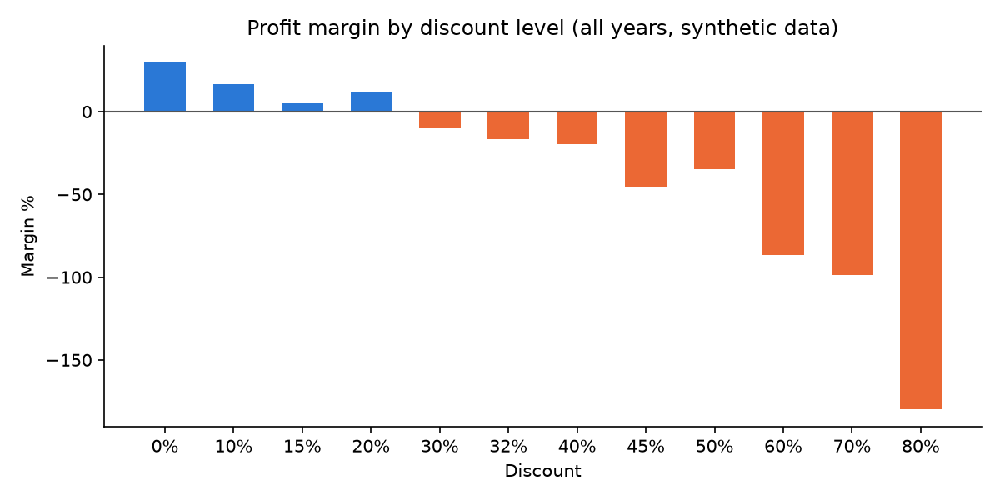
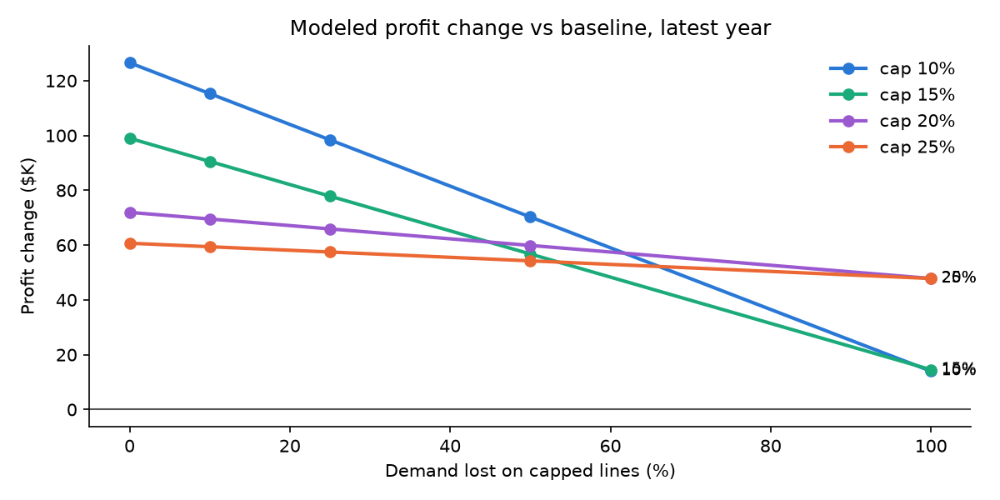

# Discount optimization: business case

> **Read this first.** The data is synthetic (Tableau Sample Superstore). The thresholds below are *observed
> associations*. The dollar figures are *modeled opportunities* from repricing 2026 order lines under stated
> assumptions. They are not savings anyone has realized, and they are not forecasts. Source: `results/scenarios.json`
> (`python -m retailpulse.scenarios`).

## Summary

| | |
|---|---|
| **Problem** | In 2026, lines discounted above 20% (463 of 3,379 lines) lost **$47.8K**, against total profit of $95.9K. |
| **Finding** | Every category is profitable at a 20% discount and loses money from 30% (Furniture), 40% (Technology) or 70% (Office Supplies). In three sub-categories (**Tables, Storage, Supplies**), the 20% level already loses money. |
| **Recommendation** | **Cap discounts at 20% company-wide**, rolled out as a controlled test. Separately, test a tighter cap in Tables, Storage and Supplies. |
| **Modeled 2026 impact of a 20% cap** | Profit **+$47.8K to +$71.9K**; **+$65.9K** if a quarter of the capped volume is lost. Margin rises from 12.87% to 20.5–22.6%. |
| **Why not tighter?** | A 10% or 15% cap shows a bigger gain on paper (up to +$98K at 25% demand loss), but it also caps about 1,250 profitable lines discounted at 15–20% (up to $33.8K profit in 2026). Its result depends almost entirely on the demand assumption: if the capped volume is lost, the gain falls to +$14K. |

## 1. How discount relates to profit (observed)

- Across all years, **lines at discounts of 30% and above lose money at every level**; 0–20% is profitable.
- Earlier analysis (`results/analysis.json`): with sub-category, region and segment held fixed, +10 points of discount
  is associated with −19.9pp of line margin (OLS, HC1; R² 0.82).

**Thresholds** come from all four years, counting only discount levels with at least 20 lines in the group.
"Loss threshold" is the lowest such level with negative margin.

| Category | Highest profitable level | Loss threshold | Profit on loss-making lines |
|---|---|---|---|
| Furniture | 20% | 30% | −$61.7K |
| Office Supplies | 20% | 70% | −$56.8K |
| Technology | 20% | 40% | −$38.6K |

| Sub-category (largest losses) | Highest profitable level | Loss threshold | Profit on loss-making lines |
|---|---|---|---|
| Binders | 20% | 70% | −$38.6K |
| **Tables** | 0% | **20%** | −$32.5K |
| Machines | 20% | 70% | −$30.1K |
| Bookcases | 20% | 32% | −$12.3K |
| Chairs | 20% | 30% | −$10.1K |
| **Storage** | 0% | **20%** | −$6.5K |
| **Supplies** | 0% | **20%** | −$3.0K |

Full table for all 17 sub-categories: `thresholds_by_sub_category` in `results/scenarios.json`.

**Products most exposed to deep discounting.** These are the products with the largest profit loss on lines
discounted above 20%, across all years.

| Product | Sub-category | Lines > 20% | Profit on those lines |
|---|---|---|---|
| Cubify CubeX 3D Printer Double Head Print | Machines | 2 | −$9.2K |
| GBC DocuBind P400 Electric Binding System | Binders | 3 | −$6.9K |
| Lexmark MX611dhe Monochrome Laser Printer | Machines | 3 | −$5.3K |
| GBC Ibimaster 500 Manual ProClick Binding System | Binders | 6 | −$5.1K |
| GBC DocuBind TL300 Electric Binding System | Binders | 4 | −$4.2K |

All ten are high-ticket machines, binding systems or conference tables. Each has only a few lines, so individual
deals drive these numbers: they are candidates for review, not established patterns.

## 2. What-if discount caps (modeled)

**Baseline (2026, actual):** revenue $745.6K, profit $95.9K, margin 12.87%.

Every scenario reprices 2026 lines discounted above the cap, at list price × (1 − cap). Two things are held fixed:

- **Cost.** A line's `implied_cost` stays the same (sales − profit, so COGS and shipping together).
- **Uncapped lines.** Any line at or below the cap is left untouched.

The demand-loss parameter **L** says what share of the capped volume no longer sells. L covers both the revenue and
the cost of those lines. L = 100% means the deeply discounted lines are simply not sold.

| Cap | Lines capped | Their 2026 profit | Profit change at L = 0% | at L = 25% | at L = 100% | Margin at L = 25% | Revenue change at L = 25% |
|---|---|---|---|---|---|---|---|
| 10% | 1,721 | −$14.0K | +$126.5K | +$98.4K | +$14.0K | 25.98% | +$2.5K |
| 15% | 1,705 | −$14.5K | +$99.0K | +$77.9K | +$14.5K | 23.82% | −$15.9K |
| **20%** | **463** | **−$47.8K** | **+$71.9K** | **+$65.9K** | **+$47.8K** | **20.95%** | **+$26.9K** |
| 25% | 463 | −$47.8K | +$60.7K | +$57.5K | +$47.8K | 20.08% | +$18.5K |

How to read it:

- **20% beats 25%.** In 2026 there are no lines between 20% and 25%, so both caps hit the same 463 lines; 20% simply
  reprices them higher.
- **20% is the "no-regret" cap.** Every discount level it touches (30%–80%) loses money today. So profit rises at any
  demand loss: at worst (L = 100%) it recovers the $47.8K those lines lost.
- **10% and 15% are bets on demand.** They reach the 15% and 20% levels, which earned $33.8K in 2026. If customers
  keep buying at a higher price, they win; if not, most of the gain disappears (+$14K at L = 100%).
- **Revenue can go either way.** At L = 100%, a 20% cap gives up $108.1K of revenue (−14.5%) to gain $47.8K of profit.

**How the recommendation was chosen.** The rule is written into `scenarios.recommend`: among caps that touch only
loss-making discount levels, take the one with the largest profit gain at L = 25%. That gives **20%**. A test checks
that the rule turns down a larger on-paper gain when that gain comes from capping profitable lines.

**Targeted caps.** The second scenario set applies caps only in Tables, Storage and Supplies, where the 20% level
already loses money. A 10% cap there touches 215 lines and models **+$18.7K** at L = 25% (+$13.3K at L = 100%). The
rule picks 10% there, because every level it touches in those three sub-categories loses money. The blanket and
targeted results overlap on 59 lines, so **do not add them together**.

## 3. Recommendation and rollout

1. **Cap discounts at 20%**, starting with Machines, Binders and Tables. These sub-categories hold the largest
   deep-discount losses and the biggest margin falls in 2026.
2. **Run it as an experiment, not a policy switch.** Randomize by region or by account, then measure margin, revenue,
   order count and customer retention against a control group. That measurement is what turns this modeled
   opportunity into a measured effect.
3. **Test a 10% cap in Tables, Storage and Supplies** as a second arm of the experiment.
4. **Review the exposed products** above, one deal at a time: who approved the discount, and why.

**Success measure.** Compare the profit change in the test group with the modeled range (+$47.8K to +$71.9K a year
at full rollout). Watch revenue and repeat purchases as the guardrails.

## 4. Assumptions, risks and limitations

| Assumption or risk | Why it matters |
|---|---|
| **Synthetic data** | The discount-to-profit relationship may be built into the data generator. Nothing here measures real customers. |
| **Observational, not causal** | Deep discounts may be a *response* to products that were already weak (clearance, damaged stock, competitive deals). Removing the discount does not remove the underlying weakness. |
| **Fixed unit cost** | `implied_cost` = sales − profit, so it bundles COGS, shipping and any allocations. If part of that cost scales with the discount (for example free shipping on promotions), the model is off. |
| **Uniform demand loss** | One L applies to every capped line. In reality, demand would drop much more for a line repriced from 80% to 20% off (a 4× price rise) than for one moving from 30% to 20%. That is why the full range, L = 0–100%, is reported. |
| **No basket or halo effects** | A loss-leader discount can bring in profitable purchases in the same order or later. The model ignores this, so a cap could cost more than shown. |
| **No competitor response, no mix shift** | Customers may switch to other products or other sellers. Neither is modeled. |
| **One year** | Scenarios use 2026 only. Thresholds use all four years. Small groups (fewer than 20 lines at a discount level) are left out of the threshold tables. |

## Method and reproducibility

- Code: `retailpulse/scenarios.py`. It reads `analytics.sales_wide` through `analysis.load_lines()`, which the rest
  of the statistics also use.
- Tests: `tests/test_scenarios.py` covers the following:
  - repricing arithmetic, worked out by hand
  - demand-loss scaling and the L = 100% bound
  - targeting
  - the no-regret rule
  - the threshold logic
  - a run through the real pipeline that must write valid JSON
- Outputs: `results/scenarios.json`, `results/scenarios.csv` and `docs/figures/*.png`, regenerated by
  `python -m retailpulse`.
